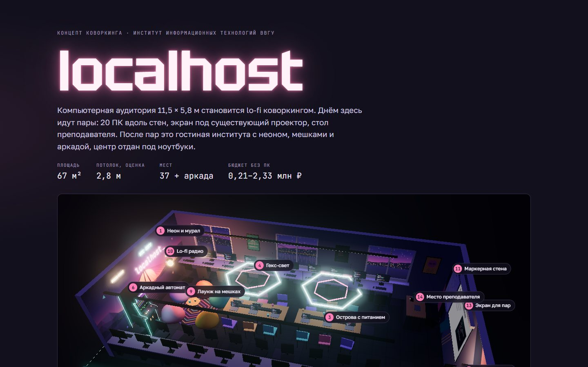
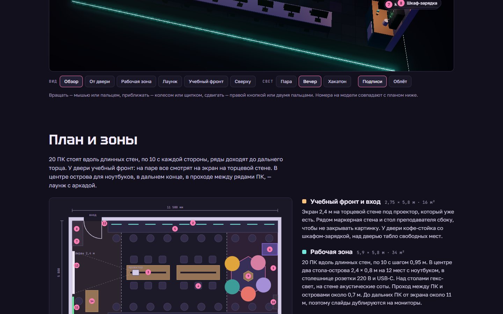
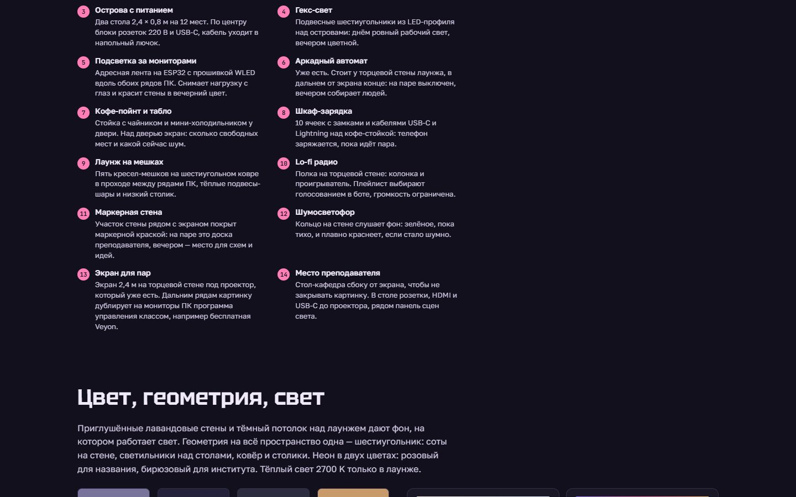

<div align="center">



# Коворкинг «localhost»

**3D-концепт IT-коворкинга для аудитории ВВГУ: планировка, зоны и смета на одной странице.**

 

</div>

<table>
<tr>
<td align="center" valign="top"></td>
<td align="center" valign="top"></td>
</tr>
</table>

<!-- header:end -->
Интерактивный 3D-концепт IT-коворкинга для аудитории ВВГУ (11,5 × 5,8 м, 20 рабочих мест): планировка, зоны и смета в одном HTML-файле на Three.js.

## Что внутри

- `index.html` — 3D-сцена аудитории: столы с ПК, зоны для пар и командной работы. Камеру можно вращать (OrbitControls). Рядом смета оснащения.
- `preview.html` — облегчённое превью для показа.

## Запуск

Открыть `index.html` в браузере. Если модули не грузятся с диска, поднять локальный сервер:

```bash
python -m http.server 8000
```

Three.js подключается с CDN, сборка не нужна.
